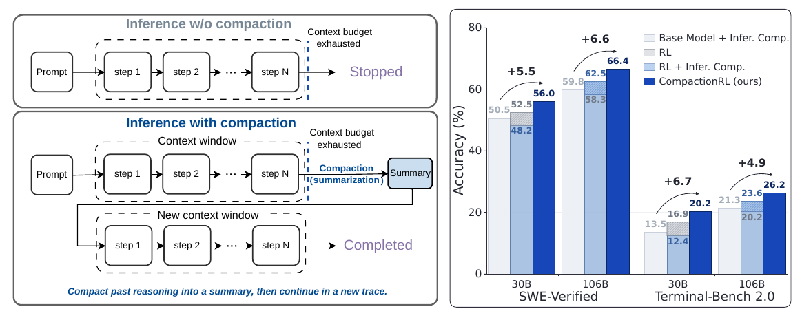
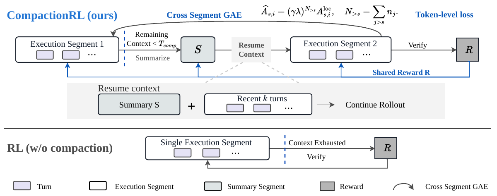

<h1 align="center">CompactionRL</h1>

<p align="center">
  <b>Reinforcement Learning with Context Compaction for Long-Horizon Agents</b>
</p>

<p align="center">
  Yujiang Li · Zhenyu Hou · Yi Jing · Jie Tang · Yuxiao Dong
</p>

<p align="center">
  <a href="https://arxiv.org/abs/2607.05378"></a>
  <a href="https://arxiv.org/pdf/2607.05378"></a>
  <a href="LICENSE"></a>
</p>

<p align="center">
  <a href="#overview">Overview</a> ·
  <a href="#results">Results</a> ·
  <a href="#repository-layout">Code</a> ·
  <a href="#getting-started">Getting Started</a> ·
  <a href="#training">Training</a> ·
  <a href="#evaluation">Evaluation</a> ·
  <a href="#citation">Citation</a>
</p>

**CompactionRL** trains agents to solve tasks and summarize their own interaction
history under a fixed context budget. When the context approaches its limit, the
policy generates a summary and continues from the compressed state. Task actions
and summary tokens learn together from the final task reward.

This repository brings together the agent framework, asynchronous RL training,
and rollout buffer, with configurations for GLM-4.7-Flash and GLM-4.5-Air-SFT.

## Overview



*Context compaction extends the interaction horizon while bounding the working
context. The figure and benchmark results are from the paper.*

Long agent trajectories accumulate tool outputs, reasoning and intermediate
state. A useful summary must preserve the information needed by later actions,
so compaction quality directly affects task success. CompactionRL makes that
summary part of the trainable policy and includes it in the RL objective.

The method combines three elements:

- **Compaction-aware rollouts.** The agent summarizes earlier history and resumes
  with the summary and recent tool-interaction pairs, allowing execution to
  continue within the context budget.
- **Joint execution and summary training.** Single-rollout, critic-based PPO
  optimizes both kinds of generated tokens using the final task reward. Token
  loss normalization accounts for different execution and summary lengths.
- **Cross-segment credit assignment.** A position correction to local GAE uses
  the number of trainable tokens in later segments to account for each segment's
  distance to the final outcome.

### Method



*Execution and summary segments share the final reward. Training retains the
original generated tokens, log probabilities and loss masks across compaction.*

For segment $s$, let $N_{>s}$ be the number of optimized tokens generated in later
segments of the same rollout. The cross-segment correction is:

$$
\hat{A}_{s,i} = (\gamma\lambda_s)^{N_{>s}} A^{\mathrm{local}}_{s,i}.
$$

This approximates trajectory-level credit assignment while keeping segments
independently batchable. Summary tokens participate in the loss; observations
and repeated context prefixes are masked. The release uses the optimized-token
count for length-adaptive lambda. Implementation details and differences from
the historical code are documented in the
[paper-to-code map](slime/compactionrl/docs/implementation.md) and [release implementation](slime/compactionrl/docs/reproduction.md#release-implementation).

Token GAE and buffer-to-training conversion are implemented directly in slime.
An optional [stepwise advantage](slime/compactionrl/docs/stepwise_advantage.md)
extension is also included.

## Results

Pass@1 accuracy (%), mean ± standard deviation over three evaluation runs:

| Backbone | Method | SWE-bench Verified (200 tasks) | Terminal-Bench 2.0 |
| --- | --- | ---: | ---: |
| GLM-4.7-Flash (30B-A3B) | Base + inference compaction | 50.5 ± 1.2 | 13.5 ± 0.9 |
| GLM-4.7-Flash (30B-A3B) | **CompactionRL** | **56.0 ± 0.4** | **20.2 ± 0.9** |
| GLM-4.5-Air-SFT (106B-A12B) | Base + inference compaction | 59.8 ± 1.9 | 21.3 ± 1.6 |
| GLM-4.5-Air-SFT (106B-A12B) | **CompactionRL** | **66.4 ± 0.7** | **26.2 ± 2.1** |

CompactionRL improves the two benchmarks by **5.5 / 6.7 points** on
GLM-4.7-Flash and **6.6 / 4.9 points** on GLM-4.5-Air-SFT compared with their
inference-compaction baselines.

These are **paper-reported results**. Reproduction with this prepared release
remains pending. SWE-bench uses the fixed 200-instance subset from Appendix A.1;
Terminal-Bench uses the full 2.0 set. Full-benchmark SWE-bench model reports have
a different evaluation scope.

## Repository Layout

```text
CompactionRL/
├── slime/                  # Complete slime framework + CompactionRL changes
│   ├── slime/              # PPO, GAE, model backends and buffer conversion
│   └── compactionrl/       # Training configs, scripts, patch, docs and tests
├── terminus/               # Harbor / Terminus-KIRA agent framework
│   ├── bin/                # TiTO Linux executable
│   ├── prompts/            # Summary, resume and offline judge prompts
│   ├── examples/           # File and compaction smoke tasks
│   └── scripts/            # Task preparation, evaluation and analysis
├── buffer/                 # Minimal SQLite buffer and rollout collector
│   ├── src/compactionrl/   # Buffer schema, service and storage helpers
│   └── data/manifests/     # SWE-Dev training task IDs
├── scripts/                # Unified training wrappers and storage setup
├── assets/                 # Paper overview and method figures
└── SOURCE_MANIFEST.json    # Source revisions and overlay scope
```

| Component | Guide | Included functionality |
| --- | --- | --- |
| **slime** | [Training guide](slime/compactionrl/README.md) | Complete upstream framework, CompactionRL GAE, token-normalized loss, buffer conversion, model initialization and training recipes |
| **Terminus** | [Agent guide](terminus/README.md) | Terminus-KIRA, context compaction, Docker tasks, verification, rollout export and TiTO |
| **buffer** | [Buffer guide](buffer/README.md) | SQLite queue, rollout collection, loss-mask metadata, batching and analysis |

slime preserves the complete official source at `41dc3b6`, including its native
models, rewards, tools, backends, examples and documentation. CompactionRL is a
[17-file overlay](slime/compactionrl/docs/slime_overlay.md) on that baseline.
TiTO runs as an independent process using the supplied
[Linux executable](terminus/bin/README.md).

## Getting Started

### Requirements

- Linux x86_64, Python **3.12**, and glibc ≥ 2.34 for the bundled TiTO executable.
- A compatible NVIDIA training environment with PyTorch, CUDA, Transformer
  Engine, SGLang, Megatron-LM and mbridge. See the
  [environment notes](slime/compactionrl/docs/environment.md) for the observed
  versions and compatibility requirements.
- Docker with the Compose plugin for task execution.
- Local model weights and prepared benchmark task environments.

The code, prompts, TiTO executable and task manifests are included here. Model
weights, benchmark images and the GPU software stack are supplied separately.
The environment notes describe the preparation environment; a fresh-machine GPU
installation has not yet been validated.

### Installation

Run the following from the repository root in an existing compatible GPU
environment. Place the repository, runtime/cache paths, training outputs and
Docker data root on a mounted data volume.

```bash
# Choose a short runtime path on a mounted data volume.
export COMPACTIONRL_WORK_DIR=/data/cr
source scripts/storage_env.sh

python3.12 -m venv --system-site-packages .venv
source .venv/bin/activate
pip install -e 'buffer[test]'
pip install -e terminus
pip install --no-deps -e slime

# Install the pinned public Megatron-LM checkout used by the Flash recipe.
bash slime/compactionrl/scripts/install_megatron.sh
export MEGATRON_PATH="$PWD/.deps/Megatron-LM"
export PYTHONPATH="$PWD/buffer/src:$PWD/slime:$PWD/terminus/src:$MEGATRON_PATH"
```

The launcher resolves the project components from this checkout and does not
source an earlier experiment repository. It redirects temporary files and
runtime caches to the selected data volume. Docker's data root is checked
separately; see [storage and launch requirements](slime/compactionrl/docs/glm47_launch.md).

## Training

### GLM-4.7-Flash: five-update smoke recipe

Use the official **GLM-4.7-Flash (30B-A3B)** HF checkpoint with
`model_type=glm4_moe_lite`. The smoke recipe targets one **8 × 80 GB GPU** node:
four GPUs shared by actor/critic and four for rollout. It uses an 8k context
budget, low concurrency and two bundled tasks, including a task designed to
trigger compaction.

**Validation status:** CPU contract tests, packaging checks and launcher dry-runs
have passed. Real GLM optimizer updates, summary gradients, checkpoint
save/resume and paper-score reproduction remain pending. The GPU allocation is
a test target; minimum resources have not been measured. CPU offload requires
substantial host RAM, so check the container's memory limit before running.

Inspect the environment and generated commands first:

```bash
export MODEL_PATH=/absolute/path/to/GLM-4.7-Flash
python slime/compactionrl/scripts/preflight.py --model "$MODEL_PATH"
bash scripts/smoke_train_glm47_flash.sh --model "$MODEL_PATH" --dry-run
bash scripts/smoke_train_glm47_flash.sh --model "$MODEL_PATH" --validate-only
```

`--dry-run` prints the service and training commands. `--validate-only` checks
assets and the actual training argument parsers with hidden GPUs and an 8 GiB
process address-space limit. The new bounded parser still awaits Linux
verification; see the [validation status](slime/compactionrl/docs/reproduction.md#validation-status).

Once the environment and resource checks pass, launch the small run:

```bash
bash scripts/smoke_train_glm47_flash.sh \
  --model "$MODEL_PATH" --steps 5 \
  --output "$PWD/runs/glm47-flash-smoke"
```

The launcher starts the SGLang router, Harbor, TiTO and buffer, then the slime
training driver. The output directory contains service logs, TensorBoard events,
the buffer database and actor/critic checkpoints. A new output directory is
required for each invocation.

To continue a successfully saved run for one further update:

```bash
bash scripts/smoke_train_glm47_flash.sh \
  --model "$MODEL_PATH" --resume "$PWD/runs/glm47-flash-smoke" \
  --steps 6 --output "$PWD/runs/glm47-flash-resume"
```

`--steps` specifies the target total rollout updates, including resumed updates.
The smoke recipe checks integration; the paper uses 50 critic-pretraining steps
and longer training. See the
[launch guide](slime/compactionrl/docs/glm47_launch.md) for ports, initialization,
checkpoint continuation and resource settings.

### Reference and paper configurations

| Configuration | Purpose |
| --- | --- |
| [Flash smoke](slime/compactionrl/configs/glm47_flash/smoke.yaml) | Five-update integration recipe, 8k context, standard PPO, one 8-GPU node |
| [Flash reference](slime/compactionrl/configs/glm47_flash/reference.yaml) | Historical GLM script adapted to this repo: VAPO/DPPO, batch 128, 80k context, 80 GPUs |
| [Flash paper](slime/compactionrl/configs/glm47_flash/paper.yaml) | Manuscript settings: 64k context, token GAE and critic pretraining |
| [Air paper](slime/compactionrl/configs/glm45_air/paper.yaml) | Manuscript settings for the 106B SFT starting model and 80k context |
| [Ablations](slime/compactionrl/configs/ablations/README.md) | Summary masking, cross-segment discount, loss normalization, context budgets and stepwise advantage |

The reference recipe requires an existing Ray cluster with this checkout, model
and prepared tasks available at the same absolute paths on all nodes:

```bash
bash scripts/train_glm47_flash.sh \
  --model "$MODEL_PATH" --dataset /absolute/path/to/prepared-swedev-tasks \
  --ray-address "$HEAD_IP:6379" --host "$HEAD_IP" --bind-host 0.0.0.0 \
  --steps 180 --output "$PWD/runs/glm47-flash-reference" --validate-only
```

After environment verification, remove `--validate-only` to launch. The Flash
launcher targets the 30B model. The Air YAML records manuscript settings and
requires model-specific cluster integration. Paper configurations still need
hardware calibration, checkpoint lineage and historical experiment reconciliation;
see [reproduction scope](slime/compactionrl/docs/reproduction.md).

## Evaluation

The repository includes task-ID manifests for:

- [SWE-Dev training](buffer/data/manifests/swedev_reference_1105.json): **1,105**
  unique IDs from the supplied reference script.
- [SWE-bench Verified evaluation](terminus/data/manifests/swe_verified_200.json):
  the fixed **200** instances listed in the paper's Appendix A.1.

Prepare Harbor-format task directories and their Docker images separately. To
validate the SWE-bench subset against a local dataset:

```bash
python terminus/scripts/prepare_tasks.py \
  --dataset /absolute/path/to/swe-verified-harbor \
  --manifest terminus/data/manifests/swe_verified_200.json \
  --output runs/swe200.json
```

For Terminal-Bench 2.0, omit `--manifest` to select all tasks in the prepared local
dataset and record its version. With the inference, Harbor and TiTO services
configured for the evaluation model, run:

```bash
python terminus/scripts/evaluate.py \
  --config slime/compactionrl/configs/glm47_flash/paper.yaml \
  --tasks runs/swe200.json --model "$MODEL_PATH" \
  --runs 3 --output runs/evaluation
```

The evaluator preserves every run and writes aggregate Pass@1 statistics.
Infrastructure failures are recorded separately and remain in the denominator;
inspect them before comparing results. The manifests identify tasks; they do
not include benchmark content or container images. Exact training-data filtering
and correspondence to the paper runs remain part of the reproduction work.

## Documentation and Checks

| Guide | Contents |
| --- | --- |
| [Training](slime/compactionrl/docs/glm47_launch.md) | Smoke/reference launch, services, storage, resume and resource requirements |
| [Paper-to-code map](slime/compactionrl/docs/implementation.md) | Locations of rollout compaction, masks, GAE, losses and evaluation |
| [slime overlay](slime/compactionrl/docs/slime_overlay.md) | Complete upstream baseline, changes and patch reconstruction |
| [Buffer protocol](buffer/docs/buffer_protocol.md) | Segment schema, token metadata, queue and collector |
| [Reproduction](slime/compactionrl/docs/reproduction.md) | Paper settings, ablations and outstanding assets |

Run the project CPU checks from the repository root after installation:

```bash
pytest -c pytest.ini -q
python -B scripts/check_release.py
```

## Acknowledgments and License

CompactionRL builds on [slime](https://github.com/THUDM/slime) and
[Harbor](https://github.com/laude-institute/harbor), with the Terminus-KIRA agent
scaffold. We thank their contributors for the training and execution frameworks.

Project code is licensed under [Apache-2.0](LICENSE). Retained upstream notices
and the TiTO distribution scope are described in
[THIRD_PARTY_NOTICES.md](THIRD_PARTY_NOTICES.md). Model checkpoints, benchmark
content and container images retain their respective licenses.

## Citation

If you use CompactionRL in your research, please cite our
[paper](https://arxiv.org/abs/2607.05378)
([PDF](https://arxiv.org/pdf/2607.05378)):

```bibtex
@misc{li2026compactionrl,
  title         = {CompactionRL: Reinforcement Learning with Context Compaction for Long-Horizon Agents},
  author        = {Yujiang Li and Zhenyu Hou and Yi Jing and Jie Tang and Yuxiao Dong},
  year          = {2026},
  eprint        = {2607.05378},
  archivePrefix = {arXiv},
  primaryClass  = {cs.LG},
  url           = {https://arxiv.org/abs/2607.05378}
}
```
